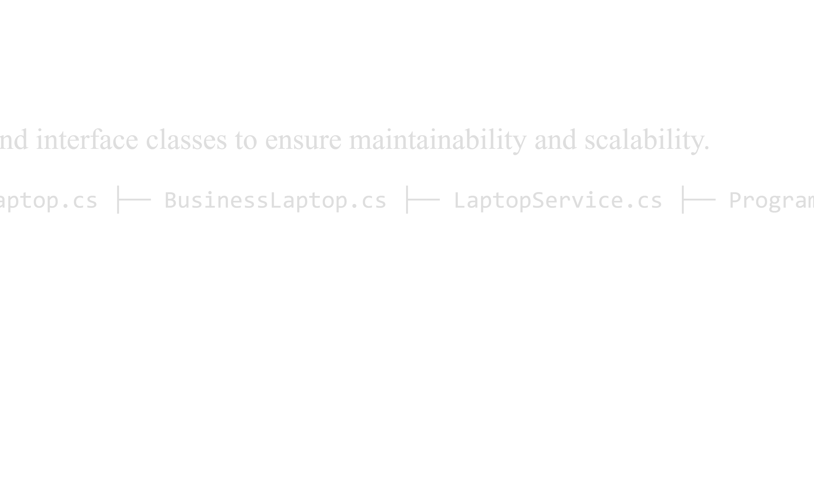

# LaptopService Project

# Description

LaptopService is a C# application designed to manage laptop records and service operations. The project applies Object-Oriented Programming (OOP) principles to create a structured, maintainable, and efficient system.

# Technologies Used

•	C#

•	.NET

•	Object-Oriented Programming (OOP)

•	Visual Studio

OOP Concepts Applied

•	Classes and Objects

•	Encapsulation

•	Inheritance

•	Polymorphism

•	Abstraction

# Main Features

•	Add new laptops

•	View laptop details

•	Update laptop information

•	Delete laptop records

•	Search for laptops

•	Manage service requests

